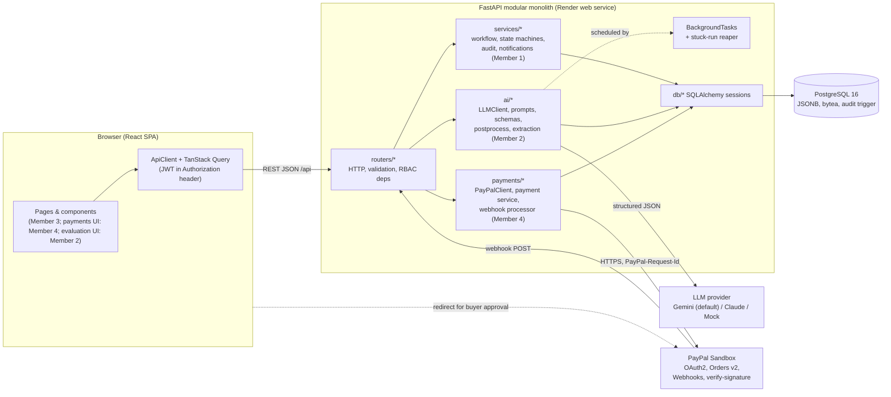
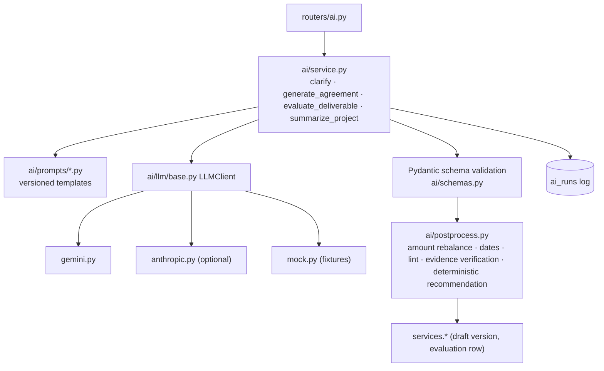
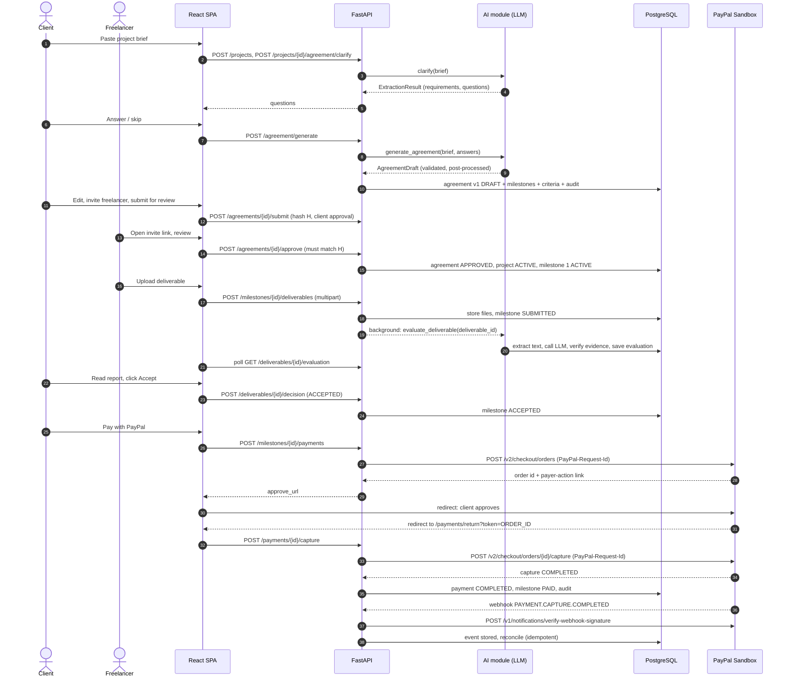
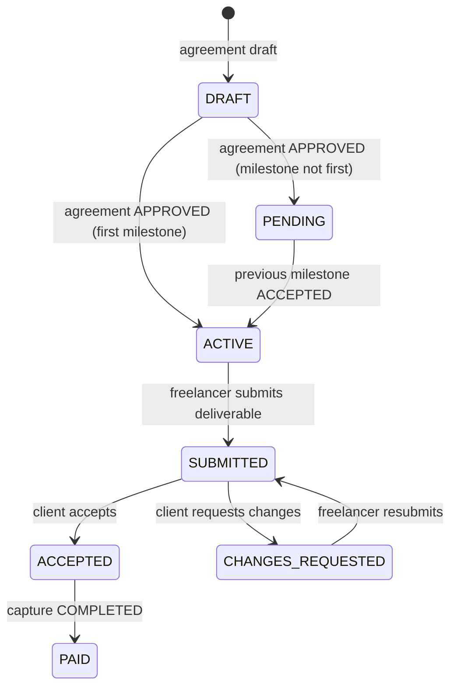
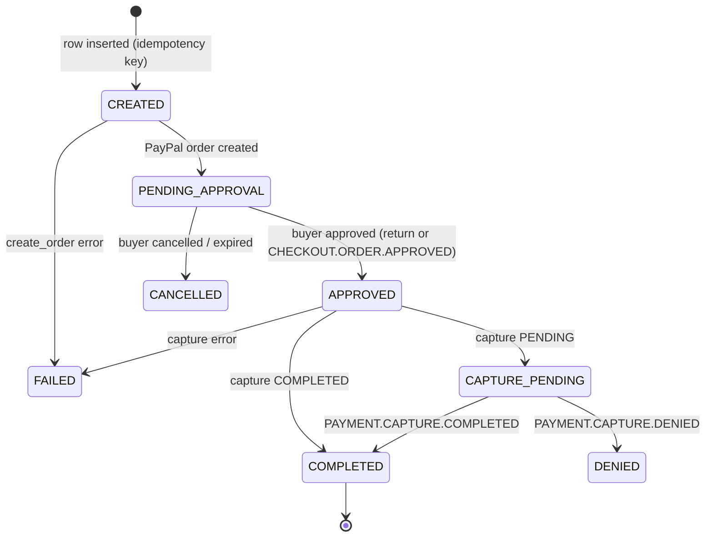
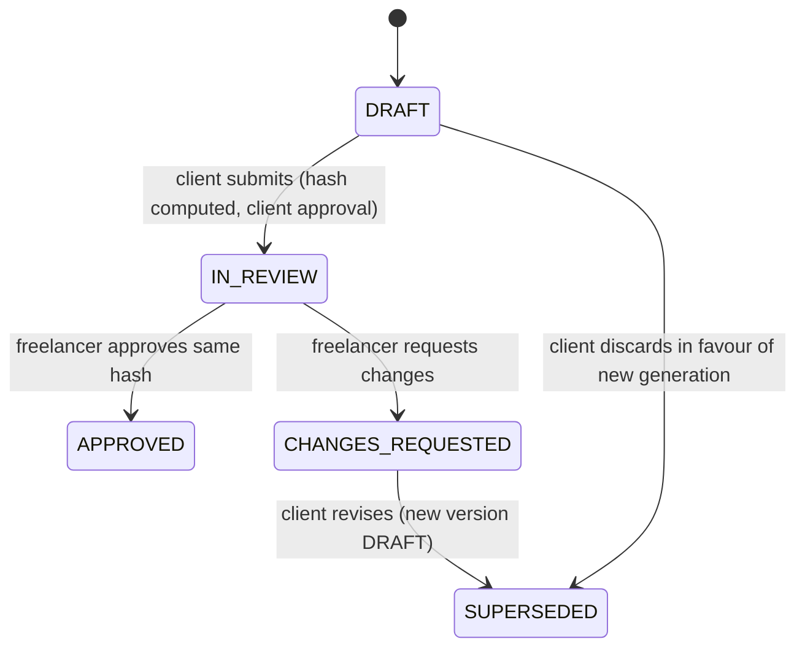

# 03 - System Architecture

## 1. Architecture principles

1. **Modular monolith.** One FastAPI service, one PostgreSQL database. No microservices, queues or caches. Modules are separated by package boundaries and ownership (doc 09).
2. **Server is the source of truth.** The frontend never sends an amount to PayPal; the backend reads it from the database.
3. **AI is advisory.** `app/ai/` can read data through service functions and write only AI-run records, drafts and evaluations. It cannot import `app/payments/` (enforced by test) and cannot change milestone status.
4. **Every external dependency has a fallback.** `AI_MODE=mock`, `PAYMENTS_MODE=mock`.
5. **Idempotency and transactions** wherever money or state moves.
6. **Boring technology.** Choices that four developers can finish in 11 days.

## 2. Technology choices and justification

| Layer | Choice | Justification | Deviation from the brief |
|---|---|---|---|
| Frontend | React 18 + Vite + **TypeScript** + Tailwind CSS | Fast dev loop; TS plus generated API types (`openapi-typescript`) is the integration contract between Member 3 and the backend | Adds TypeScript (types catch contract drift; worth it for 4 parallel developers) |
| Frontend data | React Router, TanStack Query, lucide-react | Routing, caching + polling for AI/payment status | none |
| Backend | Python 3.12, FastAPI, Pydantic v2, SQLAlchemy 2.0 (**sync**), Alembic, psycopg 3 | Auto OpenAPI; sync endpoints run in a threadpool and are simpler and less bug-prone than async for a 11-day build | Sync ORM chosen deliberately |
| Database | PostgreSQL 16 | JSONB for AI output, `bytea` for small files, partial unique indexes for payment idempotency, triggers for append-only audit | none |
| File storage | PostgreSQL `bytea` (<= 5 MB per file) | Render web services have an ephemeral disk; avoids S3/GCS setup and extra credentials | Replaces object storage |
| Background work | FastAPI `BackgroundTasks` + DB status + stuck-run reaper | Evaluation is the only long job; no Celery/Redis needed | none |
| AI | Provider-agnostic `LLMClient`; default **Gemini API** with JSON schema output; optional Anthropic Claude; **Mock** provider | Judges need meaningful AI; mock guarantees demo; swap possible by env var | Adds provider abstraction (small) |
| Payments | PayPal Sandbox, REST Orders v2, Webhooks, OAuth2 client credentials, redirect (approve-link) flow | Official APIs; redirect flow avoids shipping the client ID/JS SDK to the frontend and keeps the integration server-centric | none |
| Hosting | **Render**: web service (backend), static site (frontend), Postgres | Devpost lists Render as a sponsor with hackathon credits (see doc 13) | none |
| Source control | GitHub, trunk-based with short-lived branches, CI via GitHub Actions | doc 10 | none |

Libraries (backend): `fastapi`, `uvicorn[standard]`, `sqlalchemy>=2`, `psycopg[binary]`, `alembic`, `pydantic-settings`, `pyjwt`, `argon2-cffi`, `python-multipart`, `httpx`, `pypdf`, `python-docx`, `google-genai`, `anthropic` (optional), `pytest`, `pytest-cov`, `ruff`.
Libraries (frontend): `react-router-dom`, `@tanstack/react-query`, `lucide-react`, `clsx`, `date-fns`; dev: `openapi-typescript`, `vitest`, `@testing-library/react`, `playwright` (Member 4).

## 3. Component architecture



### Module dependency rules (enforced in code review and one test)
```
routers  ->  services, ai.service, payments.service
ai       ->  services (read helpers + create_draft_version), db
payments ->  services (mark_paid, audit, notifications), db
services ->  db            (services never import ai or payments)
```
`ai` must never import `payments`; `payments` must never import `ai`.

## 4. Frontend/backend communication

* Base path `/api`; JSON; ISO-8601 UTC timestamps; money as **decimal strings** (`"300.00"`), never floats.
* Auth: `Authorization: Bearer <JWT>`; token held in memory and mirrored to `localStorage` for reload persistence (trade-off noted in doc 14).
* Errors: uniform envelope `{ "error": { "code", "message", "details", "request_id" } }` (doc 05).
* Long operations: AI evaluation returns `202 Accepted` with an evaluation id; the UI polls `GET /api/deliverables/{id}/evaluation` every 2 s (max 90 s) via TanStack Query `refetchInterval`.
* Notifications: poll `GET /api/notifications?unread=true` every 15 s.
* Types: `npm run gen:api` runs `openapi-typescript http://localhost:8000/openapi.json -o src/api/schema.d.ts`.
* CORS: allow only `FRONTEND_BASE_URL` (+ `http://localhost:5173` in dev).

## 5. AI integration


Details: doc 06.

## 6. PayPal integration

* `payments/paypal_client.py`: OAuth token cache, `create_order`, `get_order`, `capture_order`, `verify_webhook_signature`; all POSTs send `PayPal-Request-Id`.
* `payments/service.py`: payment state machine, uniqueness guards, row locking (`SELECT ... FOR UPDATE`), calls `services.milestones.mark_paid`.
* `payments/webhooks.py`: verifies, stores, dedupes, reconciles.
* Details: doc 07.

## 7. Database interaction

* One SQLAlchemy `Session` per request (FastAPI dependency); commit at the service-function boundary; background tasks open their own session.
* Alembic owns schema; initial migration contains the full schema from doc 04.
* Row locks: payment capture and webhook reconciliation lock the `payments` row; audit insert takes `pg_advisory_xact_lock(hashtext(project_id::text))` to serialize the hash chain.

## 8. Authentication and authorization

| Concern | Design |
|---|---|
| Authentication | Email + password; `argon2id` hashing; JWT (HS256, 60 min) `sub = user_id` |
| Authorization | Dependency `require_project_member(project_id)` returns `(project, role)`; `require_role(CLIENT)` / `require_role(FREELANCER)` on mutations |
| Object-level checks | Every lookup by id joins through the project; 404 (not 403) for non-members to avoid object enumeration |
| Service identity | Webhook endpoint is unauthenticated by JWT and authenticated **only** by PayPal signature verification |
| AI | No identity; AI output is stored with `actor_type = AI` in audit |

Permission matrix:

| Action | Client | Freelancer |
|---|:--:|:--:|
| Edit brief / agreement draft | yes (while `DRAFT`) | no |
| Submit agreement for review | yes | no |
| Approve / request changes on agreement | approve (at submit) | approve / request changes |
| Submit deliverable | no | yes (`ACTIVE`/`CHANGES_REQUESTED`) |
| View evaluation | yes | yes |
| Accept / request changes on deliverable | yes | no |
| Create / capture payment | yes | no |
| View payments, audit | yes | yes |

## 9. End-to-end workflow



## 10. State machines

### Milestone


### Payment

`COMPLETED` is terminal: no later event can move a payment out of it (refunds are logged only).

### Agreement


## 11. Cross-cutting concerns

| Concern | Decision |
|---|---|
| Logging | JSON logs; `X-Request-Id` middleware; never log tokens, passwords, API keys, raw documents |
| Config | `pydantic-settings` reads env; fails fast on missing required vars for the selected modes |
| Time | All timestamps UTC `timestamptz`; due dates are `date` |
| Money | `NUMERIC(12,2)`, Python `Decimal`, API as strings |
| Rate limiting | Simple in-memory limiter on auth and AI endpoints (single instance) |
| Health | `GET /api/health` (DB ping), `GET /api/config` (modes for UI banners) |
| Deployment topology | Render: `milestonemate-api` (web), `milestonemate-web` (static), `milestonemate-db` (Postgres) |
