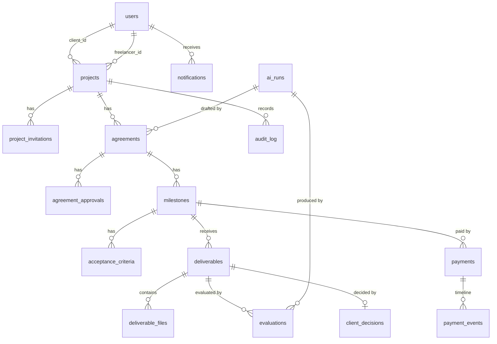

# 04 - Database Design

PostgreSQL 16. Owner: **Member 1** (schema, migrations). Table models are written by the domain owner (see doc 09) but **only Member 1 generates and merges Alembic migrations**.

## 1. Entities and relationships



## 2. Table catalogue

| Table | Purpose | Owner of model file |
|---|---|---|
| `users` | Accounts | Member 1 |
| `projects` | One client, optional freelancer, brief, AI summary cache | Member 1 |
| `project_invitations` | Hashed invite tokens | Member 1 |
| `ai_runs` | Every LLM call: kind, model, prompt version, input hash, status, latency | Member 2 |
| `agreements` | Versioned agreement header + content hash | Member 1 |
| `agreement_approvals` | Per-user decision bound to content hash | Member 1 |
| `milestones` | Milestones of an agreement version | Member 1 |
| `acceptance_criteria` | Testable criteria per milestone | Member 1 |
| `deliverables` | A submission (attempt n) for a milestone | Member 1 |
| `deliverable_files` | File bytes, hash, extracted text | Member 1 (extraction text written by Member 2) |
| `evaluations` | AI evaluation attempts + JSON report | Member 2 |
| `client_decisions` | Client accept/request-changes | Member 1 |
| `payments` | One row per payment attempt | Member 4 |
| `payment_events` | Per-payment status timeline (the transaction ledger) | Member 4 |
| `paypal_webhook_events` | Every webhook received, verified or not | Member 4 |
| `audit_log` | Append-only, hash-chained project history | Member 1 |
| `notifications` | In-app notifications | Member 1 |

## 3. SQL schema (copy into Alembic `0001_initial_schema`)

```sql
-- gen_random_uuid() is built in on PostgreSQL 13+.

-- ============ USERS ============
CREATE TABLE users (
  id            uuid PRIMARY KEY DEFAULT gen_random_uuid(),
  email         text NOT NULL,
  password_hash text NOT NULL,
  display_name  text NOT NULL CHECK (char_length(display_name) BETWEEN 1 AND 80),
  paypal_email  text,
  is_demo       boolean NOT NULL DEFAULT false,
  created_at    timestamptz NOT NULL DEFAULT now()
);
CREATE UNIQUE INDEX users_email_lower_uq ON users (lower(email));

-- ============ PROJECTS ============
CREATE TABLE projects (
  id                     uuid PRIMARY KEY DEFAULT gen_random_uuid(),
  title                  text NOT NULL CHECK (char_length(title) BETWEEN 3 AND 140),
  brief                  text NOT NULL CHECK (char_length(brief) BETWEEN 40 AND 8000),
  client_id              uuid NOT NULL REFERENCES users(id),
  freelancer_id          uuid REFERENCES users(id),
  status                 text NOT NULL DEFAULT 'DRAFT'
                         CHECK (status IN ('DRAFT','ACTIVE','COMPLETED','CANCELLED')),
  currency               char(3) NOT NULL DEFAULT 'USD' CHECK (currency = 'USD'),
  ai_summary             jsonb,
  ai_summary_state_hash  text,
  ai_summary_updated_at  timestamptz,
  created_at             timestamptz NOT NULL DEFAULT now(),
  updated_at             timestamptz NOT NULL DEFAULT now(),
  CHECK (freelancer_id IS NULL OR freelancer_id <> client_id)
);
CREATE INDEX projects_client_idx ON projects(client_id);
CREATE INDEX projects_freelancer_idx ON projects(freelancer_id);

CREATE TABLE project_invitations (
  id           uuid PRIMARY KEY DEFAULT gen_random_uuid(),
  project_id   uuid NOT NULL REFERENCES projects(id) ON DELETE CASCADE,
  email        text NOT NULL,
  token_hash   text NOT NULL UNIQUE,            -- sha256 hex of the raw token; raw token is shown once
  status       text NOT NULL DEFAULT 'PENDING'
               CHECK (status IN ('PENDING','ACCEPTED','REVOKED','EXPIRED')),
  expires_at   timestamptz NOT NULL,
  accepted_by  uuid REFERENCES users(id),
  created_at   timestamptz NOT NULL DEFAULT now()
);
CREATE INDEX invitations_project_idx ON project_invitations(project_id);
-- at most one pending invitation per project
CREATE UNIQUE INDEX invitations_one_pending_uq ON project_invitations(project_id) WHERE status = 'PENDING';

-- ============ AI RUNS ============
CREATE TABLE ai_runs (
  id           uuid PRIMARY KEY DEFAULT gen_random_uuid(),
  project_id   uuid REFERENCES projects(id) ON DELETE SET NULL,
  user_id      uuid REFERENCES users(id) ON DELETE SET NULL,
  kind         text NOT NULL CHECK (kind IN ('CLARIFY','GENERATE_AGREEMENT','EVALUATE_DELIVERABLE','SUMMARIZE_PROJECT')),
  provider     text NOT NULL,                    -- gemini | anthropic | mock
  model        text NOT NULL,
  prompt_version text NOT NULL,
  input_hash   text NOT NULL,                    -- sha256 of canonical input; raw documents are NOT stored here
  input_meta   jsonb NOT NULL DEFAULT '{}',      -- sizes, counts, file names/types (no content)
  output       jsonb,                            -- validated structured output (or null on failure)
  status       text NOT NULL CHECK (status IN ('SUCCESS','FAILED','FALLBACK')),
  error        text,
  latency_ms   integer,
  tokens_in    integer,
  tokens_out   integer,
  created_at   timestamptz NOT NULL DEFAULT now()
);
CREATE INDEX ai_runs_project_idx ON ai_runs(project_id, created_at DESC);

-- ============ AGREEMENTS ============
CREATE TABLE agreements (
  id             uuid PRIMARY KEY DEFAULT gen_random_uuid(),
  project_id     uuid NOT NULL REFERENCES projects(id) ON DELETE CASCADE,
  version        integer NOT NULL CHECK (version >= 1),
  status         text NOT NULL DEFAULT 'DRAFT'
                 CHECK (status IN ('DRAFT','IN_REVIEW','CHANGES_REQUESTED','APPROVED','SUPERSEDED')),
  title          text NOT NULL,
  summary        text NOT NULL DEFAULT '',
  scope_in       jsonb NOT NULL DEFAULT '[]',     -- array of strings
  scope_out      jsonb NOT NULL DEFAULT '[]',
  assumptions    jsonb NOT NULL DEFAULT '[]',
  payment_terms  text NOT NULL DEFAULT '',
  revision_policy text NOT NULL DEFAULT '',
  total_amount   numeric(12,2) NOT NULL CHECK (total_amount > 0),
  currency       char(3) NOT NULL DEFAULT 'USD' CHECK (currency = 'USD'),
  origin         text NOT NULL DEFAULT 'AI' CHECK (origin IN ('AI','AI_EDITED','MANUAL','TEMPLATE_FALLBACK')),
  ai_run_id      uuid REFERENCES ai_runs(id),
  content_hash   text,                            -- set at submit; sha256 hex of canonical JSON
  created_by     uuid NOT NULL REFERENCES users(id),
  created_at     timestamptz NOT NULL DEFAULT now(),
  submitted_at   timestamptz,
  approved_at    timestamptz,
  UNIQUE (project_id, version)
);
-- exactly one non-superseded ("current") agreement per project
CREATE UNIQUE INDEX agreements_one_current_uq ON agreements(project_id) WHERE status <> 'SUPERSEDED';

CREATE TABLE agreement_approvals (
  id            uuid PRIMARY KEY DEFAULT gen_random_uuid(),
  agreement_id  uuid NOT NULL REFERENCES agreements(id) ON DELETE CASCADE,
  user_id       uuid NOT NULL REFERENCES users(id),
  role          text NOT NULL CHECK (role IN ('CLIENT','FREELANCER')),
  decision      text NOT NULL CHECK (decision IN ('APPROVED','CHANGES_REQUESTED')),
  content_hash  text NOT NULL,                    -- the exact hash the user saw
  comment       text,
  created_at    timestamptz NOT NULL DEFAULT now(),
  UNIQUE (agreement_id, user_id)
);

-- ============ MILESTONES ============
CREATE TABLE milestones (
  id            uuid PRIMARY KEY DEFAULT gen_random_uuid(),
  agreement_id  uuid NOT NULL REFERENCES agreements(id) ON DELETE CASCADE,
  project_id    uuid NOT NULL REFERENCES projects(id) ON DELETE CASCADE,
  position      integer NOT NULL CHECK (position >= 1),
  title         text NOT NULL CHECK (char_length(title) BETWEEN 3 AND 140),
  description   text NOT NULL DEFAULT '',
  deliverables  jsonb NOT NULL DEFAULT '[]',      -- array of strings (expected outputs)
  amount        numeric(12,2) NOT NULL CHECK (amount > 0),
  currency      char(3) NOT NULL DEFAULT 'USD' CHECK (currency = 'USD'),
  due_date      date NOT NULL,
  status        text NOT NULL DEFAULT 'DRAFT'
                CHECK (status IN ('DRAFT','PENDING','ACTIVE','SUBMITTED','CHANGES_REQUESTED','ACCEPTED','PAID')),
  rationale     text,                             -- AI explanation of amount/deadline (optional)
  created_at    timestamptz NOT NULL DEFAULT now(),
  updated_at    timestamptz NOT NULL DEFAULT now(),
  UNIQUE (agreement_id, position) DEFERRABLE INITIALLY DEFERRED
);
CREATE INDEX milestones_project_idx ON milestones(project_id, status);
CREATE INDEX milestones_due_idx ON milestones(due_date);

CREATE TABLE acceptance_criteria (
  id                  uuid PRIMARY KEY DEFAULT gen_random_uuid(),
  milestone_id        uuid NOT NULL REFERENCES milestones(id) ON DELETE CASCADE,
  position            integer NOT NULL CHECK (position >= 1),
  text                text NOT NULL CHECK (char_length(text) BETWEEN 8 AND 500),
  verification_method text NOT NULL DEFAULT 'TEXT_EVIDENCE' CHECK (verification_method IN ('TEXT_EVIDENCE','MANUAL')),
  is_required         boolean NOT NULL DEFAULT true,
  UNIQUE (milestone_id, position) DEFERRABLE INITIALLY DEFERRED
);

-- ============ DELIVERABLES ============
CREATE TABLE deliverables (
  id             uuid PRIMARY KEY DEFAULT gen_random_uuid(),
  milestone_id   uuid NOT NULL REFERENCES milestones(id) ON DELETE CASCADE,
  submission_no  integer NOT NULL CHECK (submission_no >= 1),
  submitted_by   uuid NOT NULL REFERENCES users(id),
  note           text NOT NULL DEFAULT '' CHECK (char_length(note) <= 4000),
  links          jsonb NOT NULL DEFAULT '[]',     -- array of URLs; stored, never fetched
  status         text NOT NULL DEFAULT 'SUBMITTED'
                 CHECK (status IN ('SUBMITTED','EVALUATING','EVALUATED','EVALUATION_FAILED','ACCEPTED','CHANGES_REQUESTED')),
  created_at     timestamptz NOT NULL DEFAULT now(),
  UNIQUE (milestone_id, submission_no)
);

CREATE TABLE deliverable_files (
  id                 uuid PRIMARY KEY DEFAULT gen_random_uuid(),
  deliverable_id     uuid NOT NULL REFERENCES deliverables(id) ON DELETE CASCADE,
  filename           text NOT NULL CHECK (char_length(filename) <= 255),
  content_type       text NOT NULL,
  size_bytes         integer NOT NULL CHECK (size_bytes BETWEEN 1 AND 5242880),
  sha256             text NOT NULL,
  data               bytea NOT NULL,
  extracted_text     text,
  extraction_status  text NOT NULL DEFAULT 'PENDING'
                     CHECK (extraction_status IN ('PENDING','OK','TRUNCATED','UNSUPPORTED','FAILED')),
  created_at         timestamptz NOT NULL DEFAULT now()
);
CREATE INDEX deliverable_files_deliverable_idx ON deliverable_files(deliverable_id);

-- ============ EVALUATIONS & DECISIONS ============
CREATE TABLE evaluations (
  id              uuid PRIMARY KEY DEFAULT gen_random_uuid(),
  deliverable_id  uuid NOT NULL REFERENCES deliverables(id) ON DELETE CASCADE,
  milestone_id    uuid NOT NULL REFERENCES milestones(id) ON DELETE CASCADE,
  attempt         integer NOT NULL DEFAULT 1,
  status          text NOT NULL DEFAULT 'PENDING' CHECK (status IN ('PENDING','RUNNING','COMPLETED','FAILED')),
  provider        text,
  model           text,
  prompt_version  text,
  recommendation  text CHECK (recommendation IN ('MEETS','PARTIALLY_MEETS','DOES_NOT_MEET','INCONCLUSIVE')),
  confidence      numeric(3,2) CHECK (confidence BETWEEN 0 AND 1),
  report          jsonb,                           -- EvaluationReport (doc 06) after post-processing
  ai_run_id       uuid REFERENCES ai_runs(id),
  error_code      text,
  error_message   text,
  started_at      timestamptz,
  completed_at    timestamptz,
  created_at      timestamptz NOT NULL DEFAULT now(),
  UNIQUE (deliverable_id, attempt)
);

CREATE TABLE client_decisions (
  id             uuid PRIMARY KEY DEFAULT gen_random_uuid(),
  deliverable_id uuid NOT NULL UNIQUE REFERENCES deliverables(id) ON DELETE CASCADE,
  milestone_id   uuid NOT NULL REFERENCES milestones(id) ON DELETE CASCADE,
  decided_by     uuid NOT NULL REFERENCES users(id),
  decision       text NOT NULL CHECK (decision IN ('ACCEPTED','CHANGES_REQUESTED')),
  comment        text,
  evaluation_id  uuid REFERENCES evaluations(id),
  created_at     timestamptz NOT NULL DEFAULT now(),
  CHECK (decision = 'ACCEPTED' OR (comment IS NOT NULL AND char_length(comment) >= 3))
);

-- ============ PAYMENTS ============
CREATE TABLE payments (
  id                    uuid PRIMARY KEY DEFAULT gen_random_uuid(),
  milestone_id          uuid NOT NULL REFERENCES milestones(id),
  project_id            uuid NOT NULL REFERENCES projects(id),
  payer_id              uuid NOT NULL REFERENCES users(id),      -- the client who authorizes
  amount                numeric(12,2) NOT NULL CHECK (amount > 0),
  currency              char(3) NOT NULL DEFAULT 'USD' CHECK (currency = 'USD'),
  status                text NOT NULL DEFAULT 'CREATED'
                        CHECK (status IN ('CREATED','PENDING_APPROVAL','APPROVED','CAPTURE_PENDING','COMPLETED','FAILED','DENIED','CANCELLED')),
  provider              text NOT NULL DEFAULT 'PAYPAL' CHECK (provider IN ('PAYPAL','MOCK')),
  payee_mode            text NOT NULL CHECK (payee_mode IN ('demo_merchant','direct_payee')),
  payee_email           text,                                    -- only when direct_payee
  idempotency_key       uuid NOT NULL DEFAULT gen_random_uuid() UNIQUE,
  paypal_order_id       text UNIQUE,
  paypal_capture_id     text UNIQUE,
  paypal_order_status   text,                                    -- raw PayPal value (CREATED, PAYER_ACTION_REQUIRED, APPROVED, COMPLETED ...)
  paypal_capture_status text,                                    -- raw PayPal value (COMPLETED, PENDING, DECLINED ...)
  approve_url           text,
  failure_code          text,
  failure_message       text,
  created_at            timestamptz NOT NULL DEFAULT now(),
  updated_at            timestamptz NOT NULL DEFAULT now(),
  approved_at           timestamptz,
  captured_at           timestamptz
);
-- At most one live payment per milestone (prevents double charge on double-click / retries)
CREATE UNIQUE INDEX payments_one_live_per_milestone_uq
  ON payments(milestone_id)
  WHERE status IN ('CREATED','PENDING_APPROVAL','APPROVED','CAPTURE_PENDING','COMPLETED');
CREATE INDEX payments_project_idx ON payments(project_id, created_at DESC);

CREATE TABLE payment_events (               -- the payment transaction ledger / audit trail
  id           bigserial PRIMARY KEY,
  payment_id   uuid NOT NULL REFERENCES payments(id) ON DELETE CASCADE,
  event_type   text NOT NULL,               -- ORDER_CREATED, APPROVAL_RETURNED, CAPTURE_REQUESTED, CAPTURE_COMPLETED, WEBHOOK_RECEIVED, SYNCED, FAILED ...
  from_status  text,
  to_status    text,
  source       text NOT NULL CHECK (source IN ('API','WEBHOOK','SYSTEM','USER')),
  paypal_ref   text,                        -- order id / capture id / webhook event id
  details      jsonb NOT NULL DEFAULT '{}', -- sanitized PayPal fields (no secrets)
  created_at   timestamptz NOT NULL DEFAULT now()
);
CREATE INDEX payment_events_payment_idx ON payment_events(payment_id, created_at);

CREATE TABLE paypal_webhook_events (
  id                  uuid PRIMARY KEY DEFAULT gen_random_uuid(),
  paypal_event_id     text NOT NULL UNIQUE,   -- "id" in the webhook body; dedupe key
  event_type          text NOT NULL,
  resource_type       text,
  resource_id         text,
  verification_status text NOT NULL CHECK (verification_status IN ('SUCCESS','FAILURE','ERROR')),
  processing_status   text NOT NULL DEFAULT 'RECEIVED' CHECK (processing_status IN ('RECEIVED','PROCESSED','IGNORED','FAILED')),
  payload             jsonb NOT NULL,
  transmission_id     text,
  error               text,
  received_at         timestamptz NOT NULL DEFAULT now(),
  processed_at        timestamptz
);

-- ============ AUDIT LOG (append-only, hash-chained per project) ============
CREATE TABLE audit_log (
  id           bigserial PRIMARY KEY,
  project_id   uuid REFERENCES projects(id) ON DELETE CASCADE,
  actor_id     uuid REFERENCES users(id),
  actor_type   text NOT NULL CHECK (actor_type IN ('USER','SYSTEM','AI','PAYPAL')),
  action       text NOT NULL,                  -- e.g. AGREEMENT_SUBMITTED, DELIVERABLE_EVALUATED, PAYMENT_COMPLETED
  entity_type  text NOT NULL,
  entity_id    uuid,
  details      jsonb NOT NULL DEFAULT '{}',
  prev_hash    text NOT NULL,                  -- '0'*64 for the first row of a project
  entry_hash   text NOT NULL,                  -- sha256(prev_hash || canonical_json(row fields))
  created_at   timestamptz NOT NULL DEFAULT now()
);
CREATE INDEX audit_project_idx ON audit_log(project_id, id);

CREATE FUNCTION audit_log_immutable() RETURNS trigger AS $$
BEGIN
  RAISE EXCEPTION 'audit_log is append-only';
END;
$$ LANGUAGE plpgsql;
CREATE TRIGGER audit_log_no_update BEFORE UPDATE OR DELETE ON audit_log
  FOR EACH ROW EXECUTE FUNCTION audit_log_immutable();
-- NOTE: project deletion cascades would hit the trigger; projects are never hard-deleted in the MVP.
-- Remove ON DELETE CASCADE on audit_log.project_id if you prefer a hard failure.

-- ============ NOTIFICATIONS ============
CREATE TABLE notifications (
  id          uuid PRIMARY KEY DEFAULT gen_random_uuid(),
  user_id     uuid NOT NULL REFERENCES users(id) ON DELETE CASCADE,
  project_id  uuid REFERENCES projects(id) ON DELETE CASCADE,
  type        text NOT NULL,
  title       text NOT NULL,
  body        text NOT NULL DEFAULT '',
  link        text,                            -- in-app route, e.g. /projects/{id}/milestones/{mid}
  read_at     timestamptz,
  created_at  timestamptz NOT NULL DEFAULT now()
);
CREATE INDEX notifications_user_idx ON notifications(user_id, read_at, created_at DESC);
```

## 4. Key invariants and how they are enforced

| Invariant | Mechanism |
|---|---|
| Milestone amounts sum to `agreements.total_amount` | Service-layer check on every write + `ai/postprocess.py`; re-checked at `submit`. (Cross-row sum is not a CHECK; test `test_agreement_sum_invariant`) |
| Only one current agreement version | Partial unique index `agreements_one_current_uq` |
| Approval bound to content | `agreement_approvals.content_hash` must equal `agreements.content_hash` at approve time; edits are impossible outside `DRAFT` |
| No two live payments for a milestone | Partial unique index `payments_one_live_per_milestone_uq` |
| No duplicate webhook processing | `paypal_event_id` unique; processing guarded by status transitions |
| PayPal idempotency | `payments.idempotency_key` -> `PayPal-Request-Id` (doc 07) |
| Audit cannot be altered | Trigger `audit_log_immutable`; hash chain verifiable |
| Currency is USD | CHECK constraints (MVP) |

## 5. Content hash (agreement)

```
canonical = {
  "title","summary","scope_in","scope_out","assumptions","payment_terms","revision_policy",
  "total_amount": "1200.00", "currency": "USD",
  "milestones": [ { "position","title","description","deliverables","amount","due_date",
                    "criteria": [ {"position","text","verification_method","is_required"} ] } ... ]
}
content_hash = sha256( json.dumps(canonical, sort_keys=True, separators=(",", ":"), ensure_ascii=False) )
```
Implemented once in `services/agreements.py::compute_content_hash` (Member 1) and used by approve and audit.

## 6. Audit hash chain

```
entry_hash = sha256( prev_hash + "|" + canonical_json({
   "project_id","actor_id","actor_type","action","entity_type","entity_id","details","created_at" }) )
```
`services/audit.py::record()` takes `pg_advisory_xact_lock(hashtext(project_id::text))`, reads the latest `entry_hash` for the project (or 64 zeros) and inserts. `GET /api/projects/{id}/audit` returns entries and `chain_valid` (recomputed in Python).

### Audit action catalogue (stable strings)
`PROJECT_CREATED`, `INVITATION_CREATED`, `INVITATION_ACCEPTED`, `AGREEMENT_GENERATED`, `AGREEMENT_EDITED`, `AGREEMENT_SUBMITTED`, `AGREEMENT_APPROVED`, `AGREEMENT_CHANGES_REQUESTED`, `AGREEMENT_REVISED`, `AGREEMENT_ACTIVATED`, `DELIVERABLE_SUBMITTED`, `DELIVERABLE_EVALUATED`, `DELIVERABLE_EVALUATION_FAILED`, `DECISION_ACCEPTED`, `DECISION_CHANGES_REQUESTED`, `PAYMENT_CREATED`, `PAYMENT_APPROVED`, `PAYMENT_COMPLETED`, `PAYMENT_FAILED`, `PAYMENT_CANCELLED`, `WEBHOOK_VERIFIED`, `MILESTONE_PAID`, `PROJECT_COMPLETED`, `AI_SUMMARY_UPDATED`.

## 7. Payment transaction records

Three layers, all append-friendly:
1. `payments` - current state of each attempt (one row per attempt; at most one live).
2. `payment_events` - every transition and notable API/webhook interaction (who/what/when/from/to/PayPal reference).
3. `paypal_webhook_events` - raw verified/unverified webhook payloads (forensics, replay, dedupe).

The UI "Payment ledger" joins 1 and 2; the "Webhook verified" badge reads 3.

## 8. Migration strategy

| Rule | Detail |
|---|---|
| Tool | Alembic with autogenerate **reviewed by hand** |
| Initial migration | `0001_initial_schema` = this document (Day 1, Member 1). Includes trigger and partial indexes (written as raw `op.execute` where autogenerate cannot express them) |
| Later changes | Developer opens a PR changing the SQLAlchemy model **and** asks Member 1 in `#schema` to generate the migration; Member 1 commits `000N_<slug>.py`. Nobody else commits files in `backend/alembic/versions/` |
| Naming | `000N_short_slug.py`, linear history (no branches). Rebase if two PRs add migrations; Member 1 resolves |
| Compatibility | After Day 5, only additive migrations (new nullable columns/tables). No renames or drops |
| Local reset | `docker compose down -v && docker compose up -d db && alembic upgrade head && python -m scripts.seed_demo` |
| CI | Runs `alembic upgrade head` on empty Postgres, then `alembic downgrade base` smoke on Day 1-3 only |
| Deploy | Render `preDeployCommand`/start script runs `alembic upgrade head` before `uvicorn` |
| Seed | `scripts/seed_demo.py` is idempotent (upsert by email/title); never run in production unless `SEED_DEMO_DATA=true` |

## 9. Enumerations stored inside JSONB (not DB-constrained)
`evaluations.report.criteria_results[].status` is one of `MET`, `PARTIALLY_MET`, `NOT_MET`, `CANNOT_DETERMINE` (validated by Pydantic in `app/ai/schemas.py`, doc 06). Evaluation `recommendation` values are constrained by the table CHECK.
