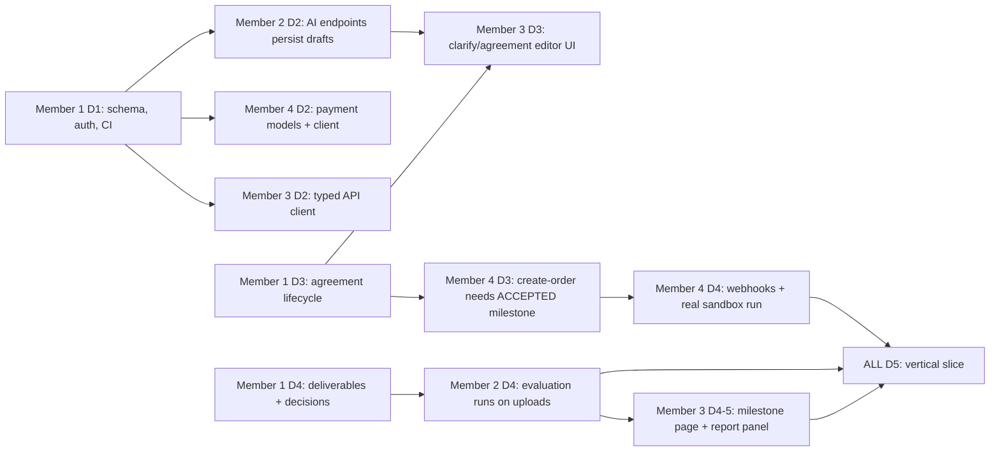

# 09 - Team Work Division

Four members, four non-overlapping primary ownership areas. Role assignment follows the suggested split; **swap names if skills differ** (decision D-01 in the final checklist) - only the names change, not the structure.

| Member | Role | One-line mission |
|---|---|---|
| **Member 1** | Tech Lead, Backend Platform and Integration Owner | Own the database, auth, workflow engine, audit, deployment, releases and merges |
| **Member 2** | AI Engineer | Own everything the LLM touches: drafting, evaluation, extraction, summaries, AI quality and fallbacks |
| **Member 3** | Frontend Lead, UI/UX | Own the React app shell, design system and all pages except two isolated feature folders |
| **Member 4** | Payments Engineer and QA Lead | Own PayPal integration, payment state machine, webhooks, and the test/E2E strategy |

**Coordinator:** Member 1 is the single integration coordinator and release manager (merges to `main`, cuts tags, runs the daily integration check, owns the deployment). Backup: Member 4.

## 1. Responsibility matrix (R = responsible, A = approves, C = consulted, I = informed)

| Area | Member 1 | Member 2 | Member 3 | Member 4 |
|---|:--:|:--:|:--:|:--:|
| Repo, CI, branch protection, releases | **R/A** | I | I | C |
| DB schema + migrations | **R/A** | C | I | C |
| Auth, users, RBAC | **R/A** | I | C | C |
| Projects, invitations | **R/A** | I | C | I |
| Agreement lifecycle (edit/submit/approve/versions/hash) | **R/A** | C | C | I |
| Audit log, notifications, dashboard API | **R/A** | C | C | C |
| Deliverable upload/storage/download | **R/A** | C (extraction) | C | I |
| AI prompts, schemas, post-processing | C | **R/A** | I | I |
| AI endpoints (`clarify`, `generate`, `evaluation`, `summary`) | C | **R/A** | C | I |
| Text extraction, evidence verification | I | **R/A** | I | I |
| AI mock mode, golden sets, AI evaluation tests | I | **R/A** | I | C |
| App shell, routing, design system, API client | I | I | **R/A** | I |
| Pages: auth, dashboard, project, agreement, milestone, activity, notifications | C | I | **R/A** | I |
| `features/evaluation/*` UI | C | **R/A** | C | I |
| `features/payments/*` UI | C | I | C | **R/A** |
| PayPal client, order create/capture, state machine | C | I | I | **R/A** |
| Webhooks + verification + reconciliation | C | I | I | **R/A** |
| Payment mock mode | I | I | C | **R/A** |
| API/integration/E2E tests, security test pass | C | C | C | **R/A** |
| Deployment (Render), env vars | **R/A** | C | C | C |
| README | **R/A** | C | I | C |
| Devpost text (AI section / PayPal section) | **A** (assembles) | **R** (AI) | C | **R** (PayPal) |
| Demo video (visuals/editing) | C | C | **R/A** | C |
| Demo script, narration, rehearsal lead | C | C | C | **R/A** |

Demo roles: **Narrator and presenter: Member 4**; **Operator (screen driver): Member 3**; **Video editing: Member 3**; **Devpost submission (Representative): Member 1** (confirm decision D-02).

## 2. Module and file ownership (no overlap)

A file or directory has exactly one owner. Anyone else changes it only through a PR that the owner approves.

### Backend
```
backend/
  app/main.py, __init__.py                          Member 1
  app/core/{config,security,deps,errors,logging,ratelimit}.py   Member 1
  app/db/{session,base}.py                          Member 1
  app/models/{user,project,invitation,agreement,milestone,deliverable,decision,audit,notification}.py   Member 1
  app/models/{ai_run,evaluation}.py                 Member 2
  app/models/{payment,payment_event,webhook_event}.py   Member 4
  app/schemas/{auth,project,agreement,milestone,deliverable,dashboard,notification}.py   Member 1
  app/schemas/{ai,evaluation}.py                    Member 2
  app/schemas/payment.py                            Member 4
  app/routers/{auth,users,projects,invitations,agreements,milestones,deliverables,decisions,dashboard,notifications,audit,health}.py   Member 1
  app/routers/ai.py                                 Member 2
  app/routers/{payments,webhooks,mock_paypal}.py    Member 4
  app/services/*.py (agreements, milestones, deliverables, decisions, projects, audit, notifications, dashboard)   Member 1
  app/ai/**                                         Member 2
  app/payments/**                                   Member 4
  alembic/**                                        Member 1 (only)
  scripts/seed_demo.py                              Member 1 (structure) ; fixtures content by Member 2
  scripts/{paypal_spike,e2e_smoke}.py               Member 4
  scripts/{ai_spike,eval_agreements,eval_deliverables}.py   Member 2
  tests/{test_auth,test_projects,test_agreements,test_deliverables,test_rbac,test_audit}*.py   Member 1
  tests/ai/**                                       Member 2
  tests/payments/**, tests/e2e/**, tests/test_architecture.py   Member 4
  requirements.txt, Dockerfile, pyproject (ruff/pytest)   Member 1 (others request additions via PR)
```
### Frontend
See doc 08 section 9. Member 3 owns everything not listed for Member 2/Member 4.

### Repo-level
```
.github/workflows/**, docker-compose.yml, render.yaml, README.md, LICENSE, .env.example    Member 1
docs/**                                           Member 1 (final consistency) ; each doc's section updates by its owner
team/<NAME>_TASKS.md                              the named member
```

## 3. Integration contracts

Contracts are **frozen at the end of the stated day**. Changing a frozen contract requires a message in the team channel, an update of this document in the same PR, and approval from both sides.

| ID | Contract | Provider -> Consumer | Frozen | Where defined |
|---|---|---|---|---|
| C1 | Database schema (all tables) | Member 1 -> all | Day 1 | doc 04 / Alembic 0001 |
| C2 | REST API + error envelope + OpenAPI types | Member 1/Member 2/Member 4 -> Member 3 | Day 1 (shapes) ; routes live per roadmap | doc 05; `npm run gen:api` |
| C3 | AI Pydantic schemas and `ai.service` signatures | Member 2 -> Member 1, Member 3 | Day 1 | doc 06 sections 2 and 4 |
| C4 | `services.agreements.create_draft_version`, `services.audit.record`, `services.notifications.notify` | Member 1 -> Member 2, Member 4 | Day 2 | below |
| C5 | `services.milestones.mark_paid`, `services.milestones.get_for_payment` | Member 1 -> Member 4 | Day 3 | below |
| C6 | `ai.service.schedule_evaluation` | Member 2 -> Member 1 (called after upload) | Day 3 | doc 06 |
| C7 | Payment public API (`payments.service`) | Member 4 -> Member 1 (dashboard queries read tables directly) | Day 3 | below |
| C8 | Frontend feature component props (`EvaluationReportPanel`, `PayMilestoneCard`, `PaymentLedger`) | Member 2/Member 4 -> Member 3 | Day 2 | section 6 |
| C9 | Environment variable names | Member 1 -> all | Day 1 | `.env.example` |
| C10 | Status enums | Member 1 -> all | Day 1 | doc 02 section 1 |

### C4 / C5 Python signatures (Member 1 provides on Day 2-3)
```python
# app/services/audit.py
def record(db, *, project_id, actor_type: str, actor_id: UUID | None, action: str,
           entity_type: str, entity_id: UUID | None, details: dict | None = None) -> None: ...
# app/services/notifications.py
def notify(db, *, user_id: UUID, project_id: UUID | None, type: str, title: str, body: str = "", link: str | None = None) -> None: ...
# app/services/agreements.py
def create_draft_version(db, *, project_id: UUID, created_by: UUID, draft: "AgreementDraft",
                         origin: str, ai_run_id: UUID | None) -> "Agreement": ...
def compute_content_hash(agreement) -> str: ...
# app/services/milestones.py
def get_for_payment(db, milestone_id: UUID, actor_id: UUID) -> "Milestone":   # raises DomainError(NOT_FOUND/FORBIDDEN/INVALID_STATE) unless client + ACCEPTED
def mark_paid(db, milestone_id: UUID, payment_id: UUID) -> None:              # milestone PAID; project COMPLETED if all PAID; audit + notify
# app/services/deliverables.py  (Member 1) calls Member 2's:
#   ai.service.schedule_evaluation(db, deliverable_id=..., background=background_tasks)
```
`DomainError(code, message, status_code, details)` lives in `core/errors.py`; every service raises it; the global handler produces the error envelope.

### C7 Payment service API (Member 4)
```python
# app/payments/service.py
def create_order_for_milestone(db, *, milestone_id: UUID, actor_id: UUID) -> Payment
def capture_payment(db, *, payment_id: UUID, actor_id: UUID, paypal_order_id: str) -> Payment
def cancel_payment(db, *, payment_id: UUID, actor_id: UUID) -> Payment
def sync_payment(db, *, payment_id: UUID, actor_id: UUID) -> Payment
def apply_verified_webhook(db, *, event: dict) -> str     # returns PROCESSED | IGNORED | FAILED
```

## 4. Dependencies between members (critical path)


Mitigation for blocking: consumers build against **mocks derived from doc 05 examples** (frontend `VITE_USE_MOCKS`, payment tests with `httpx.MockTransport`, AI `mock` provider) so nobody idles waiting.

## 5. Daily deliverables (summary; full detail in doc 11 and each `team/*_TASKS.md`)

| Day | Member 1 | Member 2 | Member 3 | Member 4 |
|---|---|---|---|---|
| 1 | Repo/CI, schema, auth | LLM client, schemas, spike | App scaffold, tokens, auth UI | PayPal sandbox, spikes S1-S8 |
| 2 | Projects, invitations, agreement CRUD, audit | clarify + generate | Dashboard, new-project step 1 | PayPal client + payment models |
| 3 | Agreement lifecycle, dashboard API | prompt tuning, fallback, golden set | Clarify UI, agreement editor, invite | Create order + capture API |
| 4 | Deliverables, decisions | Extraction, evaluation v1 | Milestone page, notifications | Webhooks, first sandbox E2E |
| 5 | **Integration lead**, fixes | Evaluation panel UI | Wire real API | Pay UI wiring, E2E script |
| 6 | Render deploy, completion logic | Eval tuning, injection tests | Tabs, activity, ledger, states | Prod webhook, failure paths, mock mode |
| 7 | Dashboard v2, seed | Summaries (P1) | Dashboard v2, audit UI | Ledger audit, reconciliation, authz tests |
| 8 | Hardening, **feature freeze** | AI regression + drills | Responsive/a11y | Test matrix, E2E |
| 9 | RC1, README, public repo | Seed content, Devpost AI text | Demo polish, screenshots | Prod dry-runs, Devpost PayPal text |
| 10 | Code freeze, tag | Verify quotas | Title cards, takes | Rehearsals x3, record |
| 11 | Submit, tag v1.0 | Standby | Edit video | Narration/QA, verify submission |

## 6. Frontend feature component contracts (C8)

```ts
// features/evaluation/EvaluationReportPanel.tsx   (Member 2)
export interface EvaluationReportPanelProps {
  deliverableId: string;
  viewerRole: "CLIENT" | "FREELANCER";
  onRetry?: () => void;                // calls POST /evaluation/retry
}
// Fetches GET /api/deliverables/{id}/evaluation with polling (2 s while PENDING/RUNNING; stops on terminal state)

// features/payments/PayMilestoneCard.tsx          (Member 4)
export interface PayMilestoneCardProps {
  projectId: string;
  milestone: { id: string; title: string; amount: string; status: string };
  viewerRole: "CLIENT" | "FREELANCER";
}
// Shows Pay button for CLIENT when status === "ACCEPTED"; receipt when "PAID"; waiting text for FREELANCER.

// features/payments/PaymentLedger.tsx             (Member 4)
export interface PaymentLedgerProps { projectId: string }
// routes owned by Member 4 but registered by Member 3 in routes.tsx:  /payments/return  /payments/cancel
```

## 7. Integration responsibilities

| Integration point | Provider | Consumer | Check |
|---|---|---|---|
| Upload -> evaluation trigger | Member 1 | Member 2 | After upload an `evaluations` row exists and `run_evaluation` is scheduled (test) |
| Evaluation done -> deliverable `EVALUATED` -> decision allowed | Member 2 | Member 1 | Decision endpoint rejects while `EVALUATING` |
| Decision `ACCEPTED` -> milestone `ACCEPTED` -> payment allowed | Member 1 | Member 4 | `get_for_payment` test |
| Capture -> `mark_paid` -> next milestone/project completion | Member 4 | Member 1 | E2E test |
| Audit + notifications from all modules | Member 1 | all | Each state change in tests asserts one audit row |
| OpenAPI -> frontend types | Member 1/Member 2/Member 4 | Member 3 | CI fails if `schema.d.ts` is stale (`npm run gen:api && git diff --exit-code`) |

## 8. Definition of done

**A task is done when all are true:**
1. Code merged to `main` through a reviewed PR (doc 10) with CI green (ruff, pytest, frontend build/tests).
2. Matches the API/UI contract; if the contract changed, the docs were updated in the same PR.
3. Unit/integration tests exist for the new logic (target: every service function and every endpoint has at least a happy-path and a permission test).
4. Error, loading and empty states handled (frontend) / error envelope used (backend).
5. No secrets, no `console.log`/`print` debugging left; logs contain no PII/secrets.
6. Audit entry and notification added where the roadmap says so.
7. Manually exercised in the browser (UI) or via curl/Postman (API) by the author; one other member re-ran it on `main` after merge.
8. Works in both `AI_MODE=mock`/`PAYMENTS_MODE=mock` and live modes where applicable.

**A day is done when** the day's end-of-day criteria in doc 11 pass and Member 1 has run the daily integration check (`scripts/e2e_smoke.py` once it exists; manual checklist before that) on `main`.
